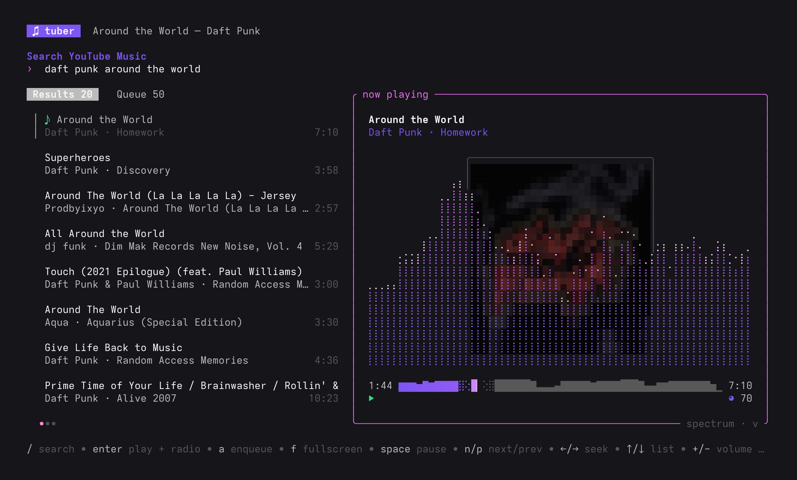
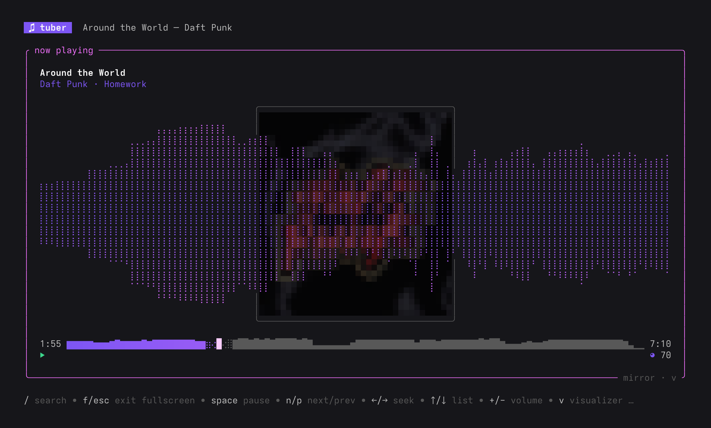

# tuber

A terminal YouTube Music player. Search, play, and let a radio mix keep the music going. It works without an account, and can optionally use yours.



## Features

- **Search** YouTube Music for songs, no account needed.
- **Radio**: playing a song fills the queue with a mix based on it.
- **Queue**: add, remove and jump between tracks; next and previous.
- **Visualizer** over the album art, in three modes: spectrum, mirrored waveform and oscilloscope.
- **Waveform seekbar** showing the shape of the whole track; seek in 5-second steps.
- **Resume**: the queue, position, volume and last search are saved locally (`~/.local/state/tuber/`), and the next launch picks up where you left off, paused.
- **Desktop integration** through MPRIS: shows in now-playing widgets with cover art, and works with media keys and `playerctl`.
- **Fullscreen** for the list or the player.
- **Optional sign-in**: liked songs, personalised mixes, plays added to your history, picking up a song from another device, and Premium audio quality. See [Sign in](#sign-in-optional).

<details>
<summary>Fullscreen player, mirror visualizer</summary>



</details>

## Prerequisites

To run:

- [**yt-dlp**](https://github.com/yt-dlp/yt-dlp), kept up to date. When YouTube changes something, updating yt-dlp is usually the fix, and distro packages can lag behind; `pipx install yt-dlp` or the standalone release stays current.
- **ffmpeg**.
- **A JavaScript runtime** for yt-dlp to solve YouTube's challenges: deno, node, bun or quickjs, whichever you have.
- A terminal with 24-bit color. Fonts with Unicode 13 block characters draw the seekbar's playhead best; kitty, WezTerm, Ghostty, foot and Windows Terminal draw them without one.

To build:

- **Rust 1.88** or newer (via [rustup](https://rustup.rs)).
- **ALSA headers** and `pkg-config`: `alsa-lib-devel pkgconf-pkg-config` on Fedora, `libasound2-dev pkg-config` on Debian and Ubuntu.

Only for signing in with a Chrome-family browser on GNOME: the Python **secretstorage** module (`python3-secretstorage`), which yt-dlp needs to read the cookie key from the keyring.

## Install

```sh
cargo install --git https://github.com/Auxnon/tuber
```

## Run

```sh
tuber                # start at the search box
tuber daft punk      # search straight away
```

## Sign in (optional)

```sh
tuber --login                     # try every browser profile, most recently used first
tuber --login chrome              # or every profile of one browser: chrome, firefox, brave, chromium, edge, vivaldi, opera
tuber --login 'chrome:Profile 1'  # or one profile
tuber --login chrome+gnomekeyring # if Chrome's cookies won't decrypt, name the keyring (gnomekeyring, kwallet, basictext)
tuber --logout
```

Sign in to [music.youtube.com](https://music.youtube.com) in your browser first. `--login` has yt-dlp copy that browser's YouTube cookies into `~/.local/state/tuber/cookies.txt`, readable only by you, and checks them by fetching your account name. While signed in:

- the header shows your account name,
- songs tuber plays for at least 10 seconds go into your YouTube Music history, like plays from the official apps,
- at launch, if your history's newest song was played on another device after tuber's last session, tuber offers it: press `c` to play it with a radio mix (from the start; YouTube doesn't sync the position within songs),
- `L` loads your liked songs,
- radio mixes and search are personalised to your account,
- yt-dlp gets the cookies too, for Premium audio quality and age-restricted tracks.

The cookies are as powerful as your browser's YouTube session, so treat the file like a password. Signing out of YouTube in the browser invalidates them; run `--login` again. If YouTube rejects them, search, radio and playback keep working anonymously. With Chrome-family browsers the keyring may ask for permission the first time, and `--login` tells you if `secretstorage` is missing.

## Keys

| key | action |
| --- | --- |
| `/` | focus list + search |
| `enter` | results: play + start radio · queue: jump to track |
| `a` | add result to queue |
| `r` | start radio from selected |
| `d` | remove from queue |
| `tab` | switch results / queue |
| `f` | fullscreen the focused pane (list or player) |
| `esc` | exit fullscreen |
| `↑`/`↓` (`k`/`j`) | focus list, then move |
| `J`/`K`, `g`/`G` | page, top/bottom |
| `space` | pause |
| `n` / `p` | next / previous (restarts track if >3s in) |
| `←`/`→` (`h`/`l`) | focus player, then seek ±5s |
| `+` / `-` | volume |
| `v` | cycle visualizer mode |
| `L` | load your liked songs into results (signed in) |
| `c` | continue the song last played on another device (when offered) |
| `q` | quit |

Picking a song from the list moves focus to the player, and in fullscreen that switches the view to the player.
