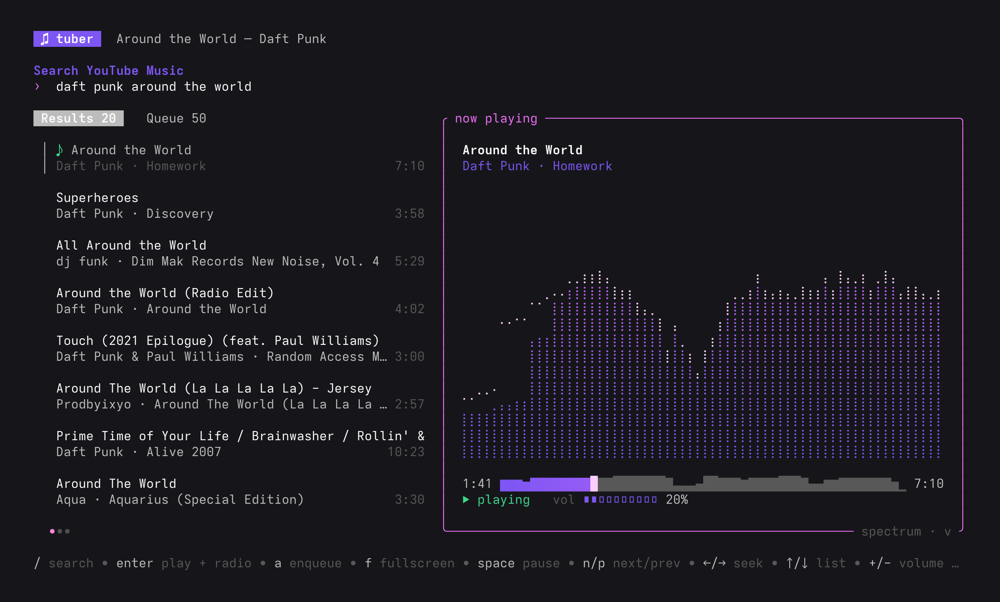
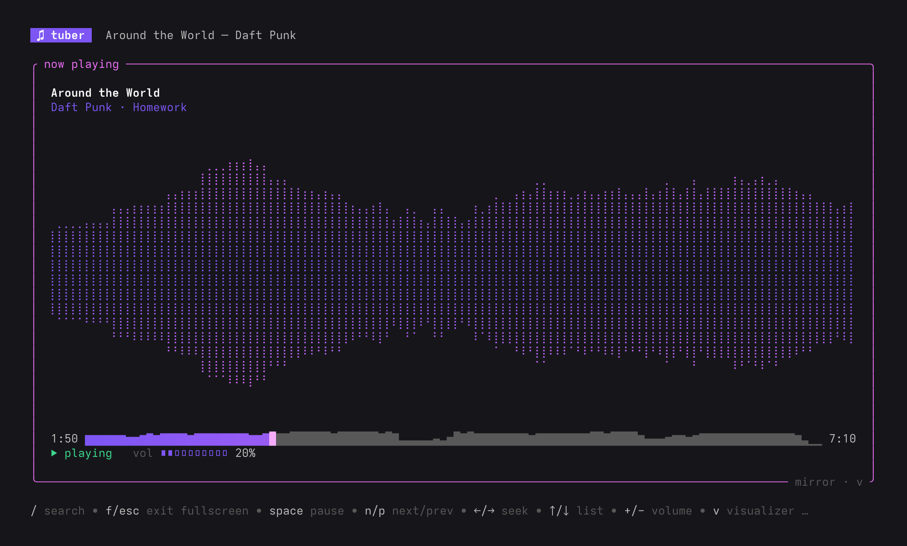

# tuber

A terminal YouTube Music player built with [ratatui](https://ratatui.rs). It needs no account or sign-in. It draws a braille audio visualizer and uses [ratatui-cheese](https://crates.io/crates/ratatui-cheese) (Charm-style) widgets and colors.



- **Search** uses YouTube Music's own InnerTube API, filtered to songs and called anonymously.
- **Radio**: pressing enter on a song plays it and fills the queue with YouTube Music's auto-generated mix for that song.
- **Playback**: `yt-dlp` resolves the stream URL, `ffmpeg` decodes it to PCM, and `cpal` plays it.
- **Waveform seekbar**: shows the shape of the whole track from a quick second ffmpeg pass. The played part is colored with a gradient, and the playhead is a sextant block (`🬏🬓▌🬭🬹█`) that matches the waveform's height at its position, fills its left then right half as it crosses each column, and flashes on beats. It needs a font or terminal with Unicode 13 sextants; kitty, WezTerm, Ghostty, foot and Windows Terminal draw them natively.
- **MPRIS**: shows up in desktop now-playing widgets (Quickshell, Waybar, GNOME and KDE) with title, artist and cover art. Media keys and `playerctl` can control it.
- **Visualizer** reads the exact samples sent to the speakers and draws them with braille dots on a ratatui `Canvas`. It has three modes: spectrum with peak caps, a mirrored waveform, and a triggered oscilloscope.

<details>
<summary>Fullscreen player, mirror visualizer</summary>



</details>

## Requirements

`yt-dlp` and `ffmpeg` on your `PATH`, plus ALSA headers to build (`alsa-lib-devel` / `libasound2-dev`).
Keep yt-dlp up to date. When YouTube changes how stream URLs are signed, updating yt-dlp is usually the fix.

## Run

```sh
cargo run --release                       # start at the search box
cargo run --release -- daft punk          # search straight away
```

## Keys

| key | action |
| --- | --- |
| `/` | focus list + search |
| `enter` | results: play + start radio · queue: jump to track |
| `a` | add result to queue |
| `r` | start radio from selected |
| `d` | remove from queue |
| `tab` | switch results / queue |
| `f` | fullscreen the focused pane (list or player) |
| `esc` | exit fullscreen |
| `↑`/`↓` (`k`/`j`) | focus list, then move |
| `J`/`K`, `g`/`G` | page, top/bottom |
| `space` | pause |
| `n` / `p` | next / previous (restarts track if >3s in) |
| `←`/`→` (`h`/`l`) | focus player, then seek ±5s |
| `+` / `-` | volume |
| `v` | cycle visualizer mode |
| `q` | quit |

Picking a song from the list moves focus to the player, and in fullscreen that switches the view to the player.
